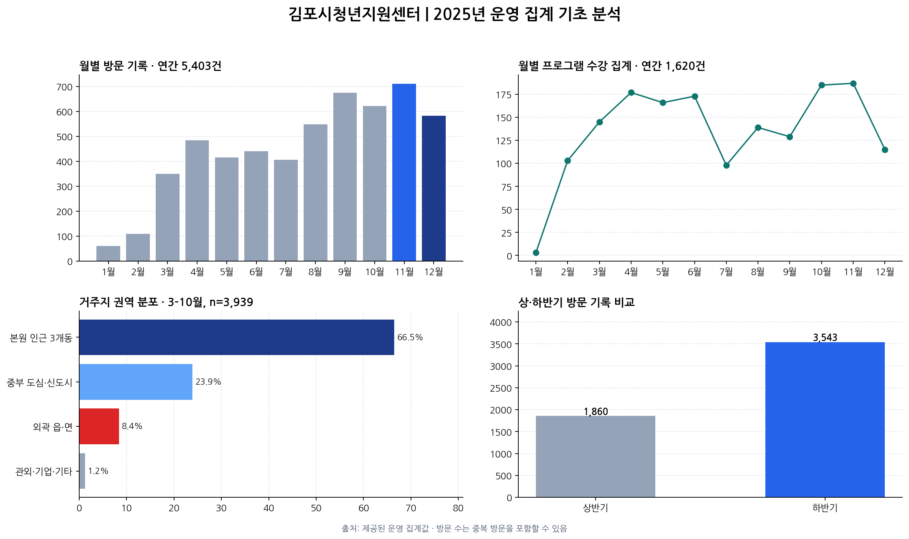

# 김포시청 - 일자리정책과 청년지원센터 데이터 기반 운영 개선 프로젝트

> **근무 기간:** 2025.11 ~ 2026.06 (데이터 & 운영 매니저)  
> **핵심 스택:** `Python` `Pandas` `NumPy` `Matplotlib` `Excel`

## 1. 프로젝트 배경 (Problem Definition)
- 민간 위탁에서 시청 직영으로 전환된 초기, 수기 명부 관리로 인한 **타임스탬프 결측 및 단기 체류 노이즈(출력·대여)**가 혼재되어 정량 평가 대응이 어려웠음.
- 평균 6회차 이상 장기 강좌 위주 편성으로 **중도 이탈률 42.4%(평균 이수율 57.6%)**가 발생하고, 본원 인근 3개동 편중(66.5%) 대비 외곽 읍·면 소외(8.4%)가 두드러짐.

## 2. 데이터 정제 및 분석 파이프라인
1. **출결 로그 표준화 (`src/preprocess_logs.py`)**
   - 시청 폐쇄망 보안 환경에 맞춘 공인 출결 로그와 외곽 6개 거점 출석부를 단일 스키마로 통합.
   - 퇴실 미체크 건에 대한 마감 보정 규칙(`19:00` 야간 점검 / `21:00` 마감) 및 `5분 미만` 단순 출력·대여 노이즈 분리 필터 적용.
   - 개인식별정보(성명·생년월일) SHA-256 해싱 및 마스킹 비식별화 처리.
2. **2025년 전수 로그 기초 EDA (`src/eda_2025_baseline.py`)**
   - 2025년 전수 방문자(5,403명) 및 프로그램 수강 연인원(1,620건, 63개 강좌) 분석을 통해 장기 과정 이탈 병목과 외곽 접근성 한계 도출.
3. **운영 개선 반영 및 KPI 검증 (`src/evaluate_2026_kpi.py`)**
   - 4회 이하 단기 모듈 개편, 외곽 6개 거점 대관, 5대 SNS 데일리 마케팅, 공간 개선(AI 면접실·탕비실) 반영.
   - 2025년 1~2월 기록 미비 구간의 착시를 배제한 **3~6월 실질 비교 구간 기준 방문자 1.67배, 수강 1.39배 성장** 및 **강좌 평균 이수율 92.4%(+34.8%p)** 달성 입증.
   - 지자체 기관 평가 **D등급 ➔ B등급** 상향 및 차년도 운영 예산 확보 기여.

## 3. 분석 및 검증 시각화 결과

### 📊 2025년 전수 운영 로그 기초 EDA (Baseline)

### 📈 2025 vs 2026 상반기 핵심 성과 지표(KPI) 검증
