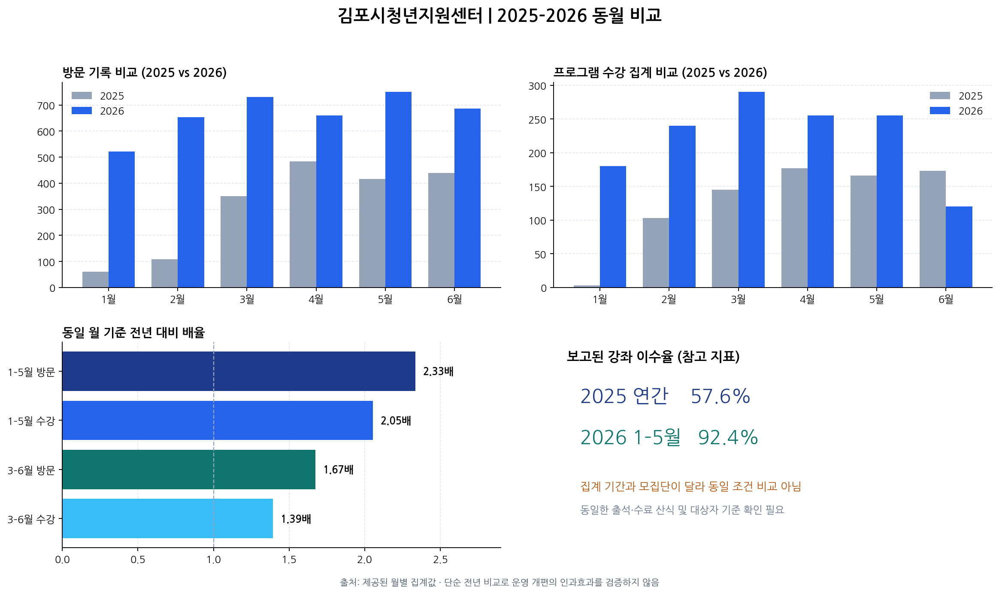
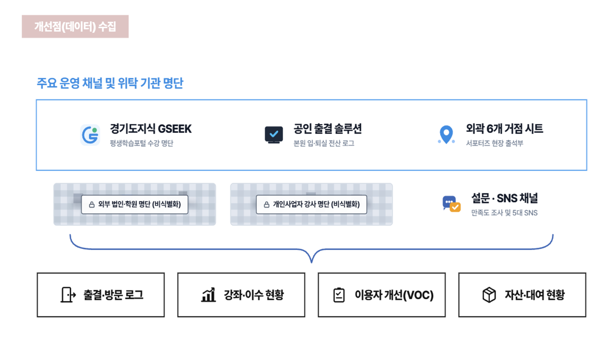
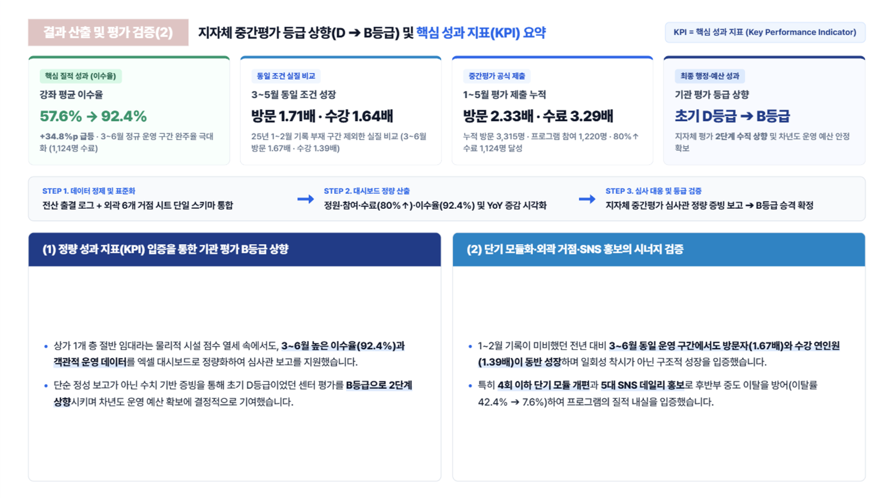
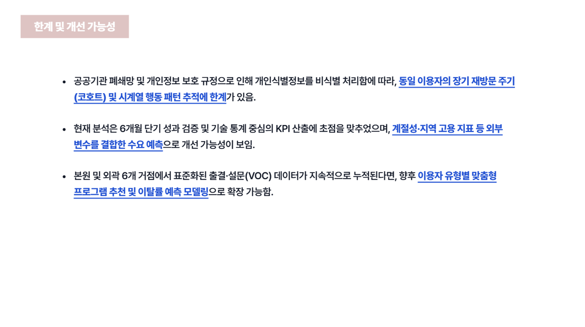

# 김포시청년지원센터 | 운영 데이터 분석 및 KPI 비교

2025년 김포시청년지원센터의 **민간위탁 → 직영 전환** 과정에서 운영 기록을 정비하고, 2026년 5월 첫째 주 운영 평가에 대비한 지표 관리와 개선안 수립을 지원한 업무입니다. 2025년 실적을 기준선으로 삼아 2026년 동일 월의 방문·수강 현황을 비교했습니다.

**업무 참여** 2025년 11월부터 · **담당** 출결·운영 데이터 정리, 지표 분석, 평가 보고자료 작성 및 운영 개선 지원

> 2025년은 주로 **분석 대상이 되는 기존 운영 실적**이며, 2025년 1월부터 운영을 직접 담당했다는 의미가 아닙니다.

## 배경과 목표

- **운영 전환:** 이전 평가에서 드러난 운영상 과제를 개선하기 위해 2025년 민간위탁에서 직영 방식으로 전환했고, 구래점 운영 종료 등 거점 재편이 함께 진행됐습니다.
- **당면 과제:** 2026년 5월 첫째 주 예정된 평가에 맞춰 출결 집계와 보고 기준을 정비하고, 이용자 수요에 근거한 프로그램·홍보·거점 운영 개선안을 준비했습니다.
- **개인 수행 범위:** 기존 운영 기록의 데이터화·정합성 확인, 전년 동월 비교 및 보고용 시각화, 설문·현장 피드백 정리와 개선안 협의입니다. 센터 직영 전환이나 기관 평가 전체를 단독으로 주도했다는 의미는 아닙니다.

## 주요 지표.

| 구분 | 2025년 | 2026년 | 비교 |
|---|---:|---:|---:|
| 1–5월 방문 기록 | 1,420건 | 3,315건 | **2.33배** |
| 1–5월 프로그램 수강 집계 | 594건 | 1,220건 | **2.05배** |
| 3–6월 방문 기록 | 1,690건 | 2,827건 | **1.67배** |
| 3–6월 프로그램 수강 집계 | 661건 | 920건 | **1.39배** |

두 비교 구간은 모두 **양년도 같은 월**의 합계를 사용합니다. 2025년 1–2월 초기 기록이 미비하다는 설명을 고려해 3–6월 비교도 별도로 제시했습니다. 방문 건수는 중복 방문을 포함할 수 있으며, 인원 수와 동일한 지표로 취급하지 않습니다.

기존 자료에 제시된 강좌 이수율은 **2025년 연간 57.6%, 2026년 1–5월 92.4%**입니다. 집계 기간과 모수 확인이 필요하므로, 위 동월 비교 표에 혼합하지 않았습니다.

## 수행 범위

- **기준선 분석:** 2025년 방문·프로그램 집계, 거주지 권역별 분포 및 참여 현황 확인
- **운영 데이터 정비:** 출결·방문 기록의 입력 형식 통일, 퇴실 누락·시간 오류 구분, 현장 자료 확인
- **지표 비교:** 2025–2026년 동일 월 실적의 증감 확인 및 운영 보고용 차트 작성
- **운영 개선안:** 이용자 설문과 현장 건의 내용을 바탕으로 거점 운영·프로그램·홍보 방향 검토

분석 결과는 **평가 대응을 위한 운영 실적과 개선 필요 영역을 정리한 근거자료**로 사용했습니다. 전년 대비 지표만으로 특정 조치가 증가를 유발했다고 판단하지는 않습니다.

## 분석 결과

### 2025년 기준선


2025년 월별 기록 합계는 **방문 5,403건, 수강 1,620건**입니다. 3–10월 거주지 권역별 집계는 3,939건이며, 본원 인근 3개 동이 2,619건(66.5%)을 차지했습니다.

### 2026년 동월 비교



지표는 코드를 통해 재계산하며, 계산 내역은 [`outputs/2026_kpi_comparison.json`](outputs/2026_kpi_comparison.json)에 저장됩니다. 원본 수집 데이터를 GitHub에 공개하지 않았기 때문에 **공개된 집계값으로 동일한 계산을 실행하는 방식**입니다.

## 프로젝트 발표 자료

프로젝트 목표부터 데이터 수집, 분석, 운영 개선 및 평가 검증까지 **9장의 발표 자료를 순서대로 배치**했습니다.

### 01. 목표


### 02. 진행 과정


### 03. 문제 정의


### 04. 개선점(데이터) 수집



### 05. 정기 분석 및 개선방향 (1)


### 06. 정기 분석 및 개선방향 (2)


### 07. 결과 산출 및 평가 검증 (1)


### 08. 결과 산출 및 평가 검증 (2)



### 09. 한계 및 개선 가능성



---

### 평가와 대외 성과의 구분

- **운영 평가:** 프로젝트 발표 슬라이드에는 평가 결과가 **D→B등급**으로 기재되어 있습니다. 다만 세부 평가 점수와 공식 통보 문서는 대외 비공개이므로 이 저장소에서는 독립 검증 자료로 제시하지 않습니다.
- **공모 선정:** [김포시 청년성장프로젝트 선정 및 국비 4,200만 원 확보 보도(2026.05.14)](https://www.24news.kr/news/articleView.html?idxno=232875)는 **별도의 공모 선정 성과**입니다. 기사에 평가등급 상향이나 데이터 분석이 국비 확보의 직접적인 원인이라는 내용은 없습니다.

운영 지표 개선, 내부 평가 결과, 공모 선정은 각각 성격이 다른 성과로 분리해 기록했습니다.

## 코드 구성

```text
.
├── data/
│   └── aggregates.json              # 공개 가능한 집계값 (개인별 기록 제외)
├── src/
│   ├── metrics.py                   # 기간 검증 및 KPI 계산
│   ├── charting.py                  # 차트 공통 설정
│   ├── eda_2025_baseline.py         # 2025년 EDA
│   ├── evaluate_2026_kpi.py         # 동일 기간 YoY 비교
│   └── preprocess_logs.py           # 기관 내부용 출결 전처리
├── scripts/
│   └── make_demo_workbook.py        # 합성 샘플 생성
├── tests/                           # 집계 검증 및 전처리 테스트
├── slides/                          # 발표 자료 9장
├── outputs/                         # 공개 집계 기반 차트
└── docs/
    └── metric_definitions.md
```

### 실행

Python 3.10 이상을 권장합니다.

```bash
python -m pip install -r requirements.txt
python src/eda_2025_baseline.py
python src/evaluate_2026_kpi.py
```

비공개 출결 파일 전처리는 **내부 사용 권한이 있는 환경에서만** 수행합니다. 공개 저장소에는 실행 예시를 위해 합성 Excel 파일 생성기도 포함했습니다.

```bash
python scripts/make_demo_workbook.py
python src/preprocess_logs.py --input-dir data/private
```

```bash
python -m pip install -r requirements-dev.txt
python -m pytest -q
```

## 데이터 관리와 분석 범위

- 실제 출결·방문 데이터와 개인정보가 포함된 Excel/CSV는 저장소에 포함하지 않습니다.
- `data/aggregates.json`은 기존 분석 자료에 적힌 **집계 수치를 옮긴 파일**이며, 외부 공개용 원본 데이터가 아닙니다.
- 퇴실 미입력 기록은 임의 체류시간으로 보정하지 않고 누락으로 표시합니다.
- 단기 방문 및 출력·대여 목적 방문은 삭제하지 않고 별도 유형으로 구분합니다.
- 공개 코드로 계산되는 동월 증가율과, 별도 행정 자료에 의존하는 수료율·기관 평가 결과는 구분합니다.

상세한 산식과 점검 사항은 [지표 정의 및 검증 범위](docs/metric_definitions.md)에 기록했습니다.
