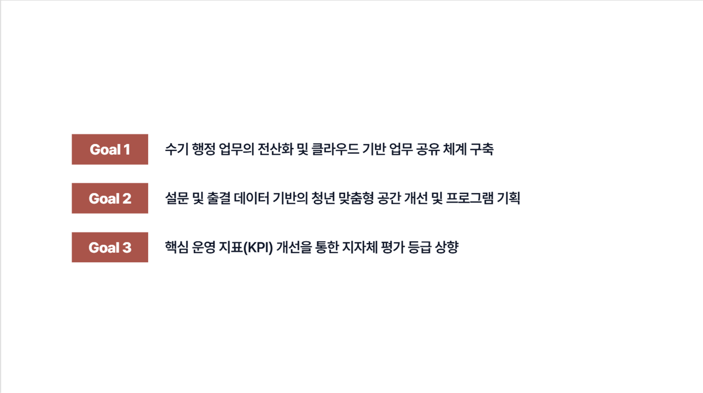
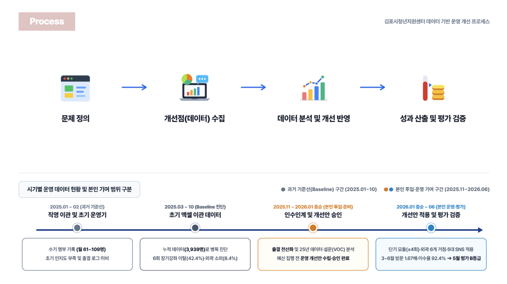
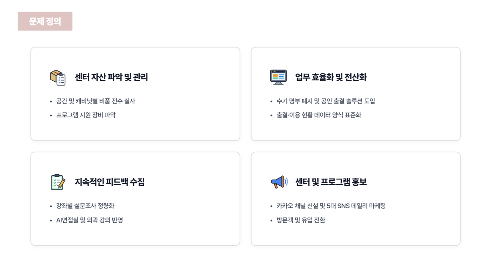
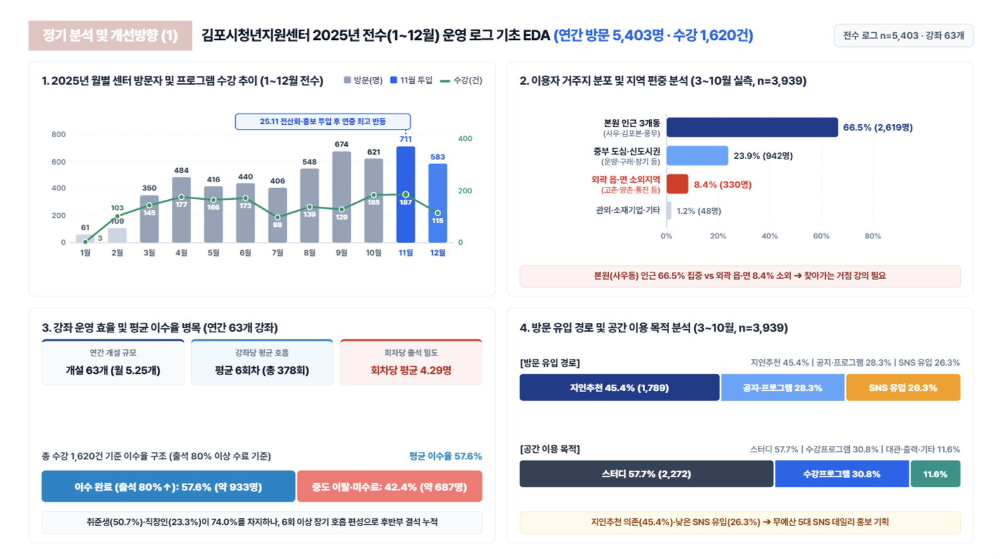
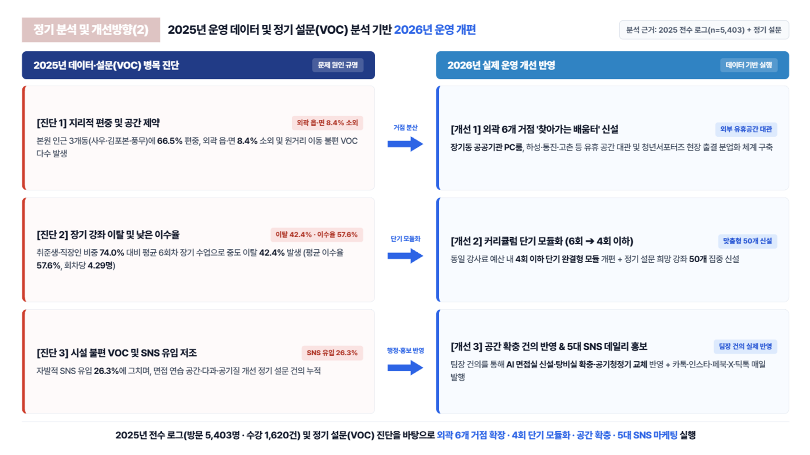
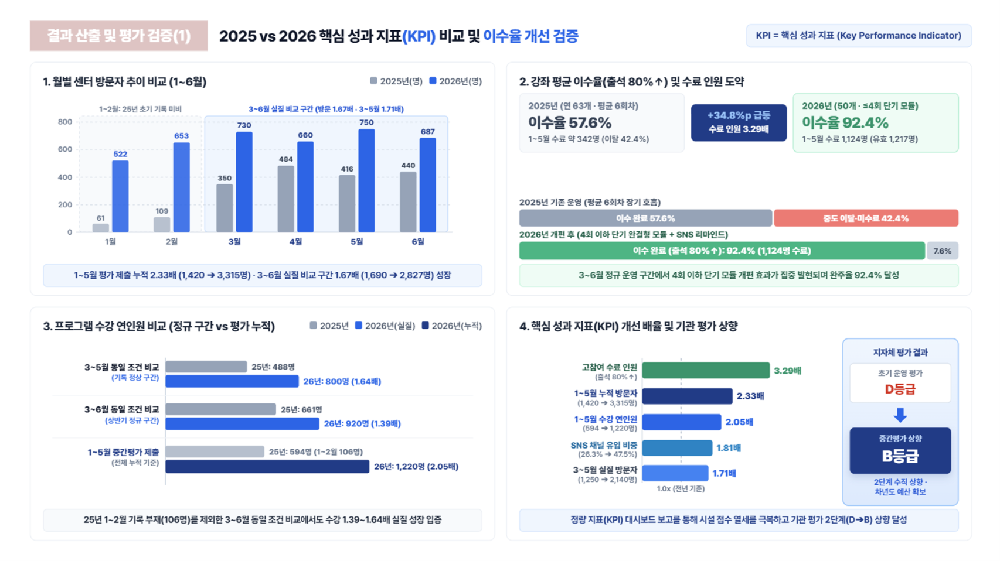
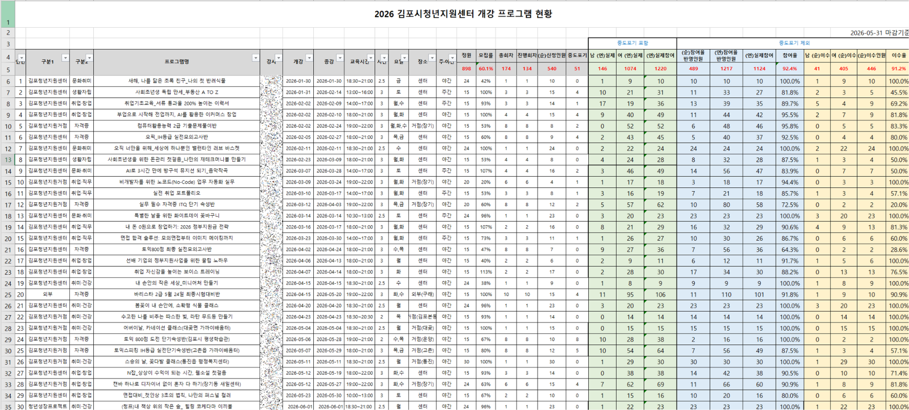
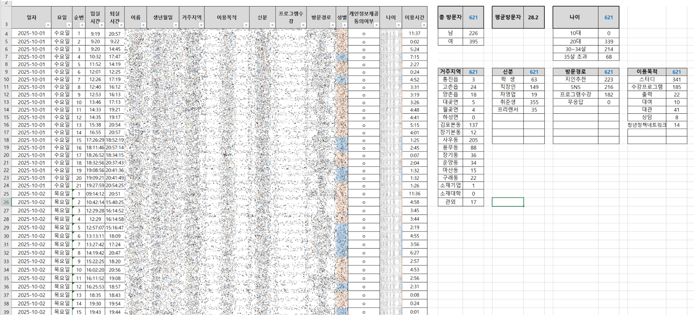
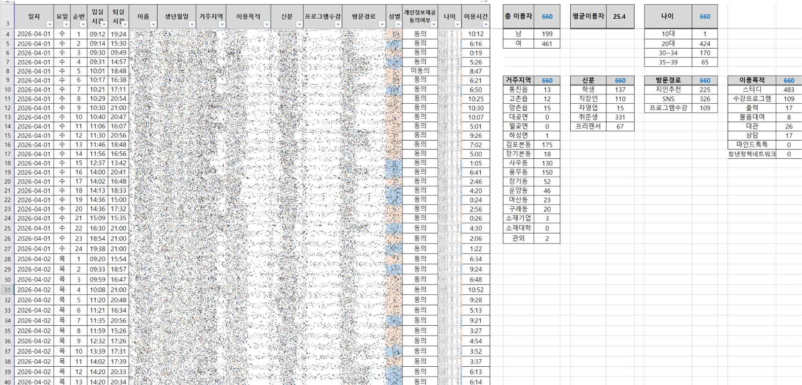

# 📊 김포시청년지원센터 데이터 기반 운영 개선 및 핵심 지표(KPI) 고도화

> **근무 기간:** 2025.11 ~ 2026.06 (8개월) | **담당 역할:** 데이터 매니저 (출결·설문 데이터 표준화 및 분석 100%, 운영 개편 기획 주도)

---

## 1. 프로젝트 요약 (STAR)

- **Situation** : 민간 위탁에서 직영으로 전환된 청년지원센터의 초기 운영 평가가 저조(D등급)하여, 예산 확보를 위한 등급 상향 및 운영 정상화가 시급했음.
- **Task** : 센터 업무 전산화 및 이용자 설문(피드백) 데이터 분석을 통해 기존의 비효율을 개선하고, 차년도(2026년) 맞춤형 센터 운영 전략 수립.
- **Action** : 수기 출결 및 행정 업무를 전용 시스템과 클라우드로 전산화함. 매월 프로그램 종료 후 설문조사를 실시해 이용자 니즈(AI 면접실·탕비실 확충, 장기동 등 외곽 지역 컴퓨터 수업 개설)를 도출하고 팀장 건의를 통해 실제 운영에 반영함. 더불어 5대 SNS 채널을 활용해 타겟 홍보를 진행함.
- **Result** : 1~5월 평가 제출 기준 전년 동기 대비 센터 방문자 2.33배(3~6월 실질 1.67배), 프로그램 수강 연인원 2.05배(3~6월 실질 1.39배), 80% 이상 고참여 수료 인원 3.29배 증가(평균 이수율 92.4%) 달성.

---

## 2. 프로젝트 상세 슬라이드 (1 ~ 9p)















---

## 3. 데이터 보안 및 시트 스키마 예시

> ※ 공공기관 개인정보 보호 및 내부 보안 규정에 따라 원본 데이터(`.xlsx`, `.csv`)는 저장소에 포함하지 않았으며, 개인식별정보(성명·생년월일·강사명 등)를 완전 비식별화(모자이크)한 실제 운영 시트 캡처로 데이터 스키마를 증빙합니다.

| 2025 출결·방문 로그 (표준화 전) | 2026 출결·방문 로그 (표준화 후) | 2026 개강 프로그램 이수 현황 |
| :---: | :---: | :---: |
|  |  |  |

---

## 4. 디렉토리 구조 및 실행 환경

```text
gimpo-youth-center-analytics/
├── src/
│   ├── preprocess_logs.py      # 본원·외곽 거점 출결 로그 스키마 통합, PII 비식별화 및 단기 체류 노이즈 분리
│   ├── eda_2025_baseline.py    # 2025년 전수 로그 기초 EDA (월별 추이, 거주지 편중, 이수율 병목 진단)
│   └── evaluate_2026_kpi.py    # 2025 vs 2026 전년 동기 대비(YoY) KPI 증분 검증 및 심사 대응 지표 산출
├── slides/                     # 프로젝트 전체 분석 및 성과 검증 슬라이드 (1.png ~ 9.png)
├── outputs/                    # 주요 분석 결과 시각화 차트 모음
├── sample_data/                # 비식별(모자이크) 처리된 실제 운영 데이터 시트 스키마 예시
├── requirements.txt            # 실행 환경 패키지 명세
└── README.md